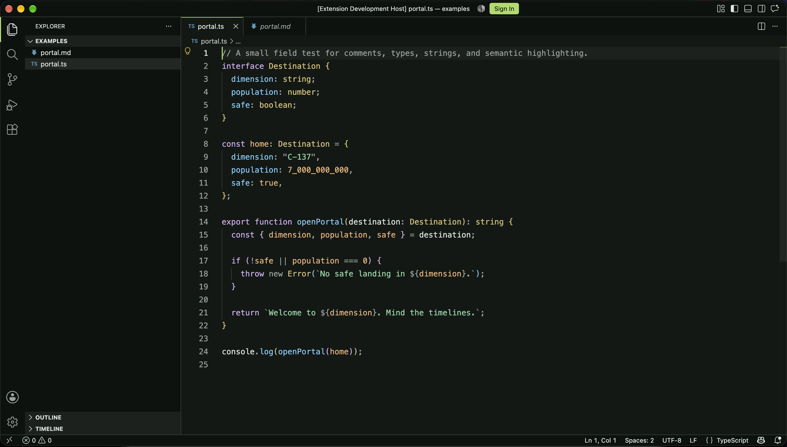
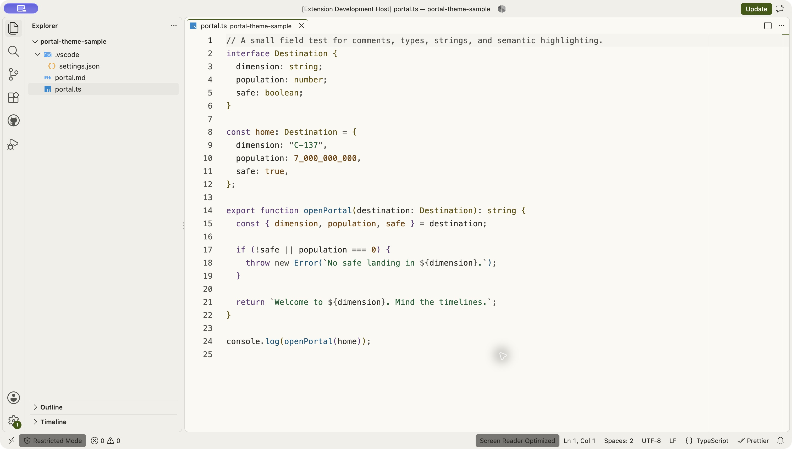

# Rick and Morty — Portal Themes

[](https://marketplace.visualstudio.com/items?itemName=aaishika.rick-and-morty)
[](https://marketplace.visualstudio.com/items?itemName=aaishika.rick-and-morty)
[](LICENSE)

A little interdimensional green. An editor you can work in all day.

This started as an early VS Code learning project and a tribute to Rick and Morty. The Portal refresh keeps that playful starting point, with more attention to the things you look at for hours: comments, selections, errors, and the code itself.

Portal green marks active tabs, buttons, and keyboard focus. The surrounding surfaces stay quiet, while distinct syntax colors help separate functions, strings, types, and constants. Both appearances include coordinated workbench and terminal colors.

| Theme            | Background            | Accents and syntax                    |
| ---------------- | --------------------- | ------------------------------------- |
| **Portal Dark**  | Green-tinted charcoal | Soft lime accents and pastel syntax   |
| **Portal Light** | Warm ivory            | Deep moss accents and ink-dark syntax |

[Previews](#preview) · [Install](#install) · [Palette](#palette) · [Customize](#customize) · [Accessibility](#contrast-and-accessibility) · [Contribute](#feedback-and-contributions)

## The 0.1.0 refresh

**Unreleased:** these changes are available in this repository and local VSIX builds. The Marketplace badge above tracks the published version.

- **Two appearances:** the original dark theme becomes Portal Dark, joined by a separately tuned Portal Light.
- **Readable details:** brighter dark-theme numbers and invalid tokens, visible Markdown fences, and consistent nested JSON keys.
- **More complete coverage:** semantic highlighting, terminal colors, Git diffs, suggestions, and keyboard focus.
- **Checks before release:** automated contrast checks run for both palettes during development and packaging.

Existing users keep their dark-theme selection after upgrading. See the [changelog](CHANGELOG.md) for the full update history.

## Preview

### Portal Dark



### Portal Light



Screenshots show the included [TypeScript sample](examples/portal.ts). Fonts, file icons, and window layout follow your VS Code setup; they are not bundled with the theme.

## Install

Find [Rick and Morty on the Visual Studio Marketplace](https://marketplace.visualstudio.com/items?itemName=aaishika.rick-and-morty), or search for `aaishika.rick-and-morty` in VS Code's Extensions view.

Open the Command Palette (`Cmd+Shift+P` on macOS, `Ctrl+Shift+P` on Windows/Linux), run **Preferences: Color Theme**, and choose **Rick and Morty: Portal Dark** or **Rick and Morty: Portal Light**.

If you're trying an unpublished build, run **Extensions: Install from VSIX…** and select the locally packaged `.vsix` first. See [Develop and package](#develop-and-package) to build one from this repository.

### Follow your system appearance

The dark theme retains the original `Rick and Morty Theme` settings ID, so existing selections keep working after an update. To follow your system appearance, add this to your VS Code settings:

```json
{
  "window.autoDetectColorScheme": true,
  "workbench.preferredDarkColorTheme": "Rick and Morty Theme",
  "workbench.preferredLightColorTheme": "Rick and Morty: Portal Light"
}
```

## Palette

The same roles carry across both appearances. Light colors are tuned independently so the accent and syntax remain readable on ivory.

| Role                  | Portal Dark | Portal Light |
| --------------------- | ----------- | ------------ |
| Editor background     | `#121814`   | `#faf9f2`    |
| Editor text           | `#dfe7e1`   | `#2a2924`    |
| Comments              | `#99a19b`   | `#53534d`    |
| Portal accent / focus | `#a9db61`   | `#3e5a04`    |
| Functions and methods | `#79ccfb`   | `#00577a`    |
| Strings               | `#88d5a3`   | `#036035`    |
| Keywords              | `#d6aef4`   | `#613d7a`    |
| Numbers and constants | `#f0b376`   | `#734300`    |
| Types and namespaces  | `#d6c06f`   | `#5f4f00`    |

## Customize

Open **Preferences: Open User Settings (JSON)** to adjust the theme. Scope overrides to the theme's settings ID so a dark-theme adjustment does not carry over when you switch to light.

For example, to make comments as bright as the surrounding text in Portal Dark:

```json
{
  "editor.tokenColorCustomizations": {
    "[Rick and Morty Theme]": {
      "comments": "#dfe7e1"
    }
  },
  "editor.semanticTokenColorCustomizations": {
    "[Rick and Morty Theme]": {
      "rules": {
        "comment": "#dfe7e1"
      }
    }
  }
}
```

Portal Dark uses the original `Rick and Morty Theme` settings ID for compatibility. Portal Light uses `Rick and Morty: Portal Light`.

### If something looks different

- **Backgrounds or text do not match the previews:** check `workbench.colorCustomizations`, `editor.tokenColorCustomizations`, and `editor.semanticTokenColorCustomizations` in both user and workspace settings. Global overrides take priority over a theme.
- **A symbol changes color after a file loads:** its language service may have supplied semantic tokens. Use **Developer: Inspect Editor Tokens and Scopes** to see which rule applies.
- **Fonts, icons, or spacing differ:** those are separate VS Code settings. The theme changes colors and token emphasis.

## Contrast and accessibility

See [the accessibility audit](docs/accessibility.md) for findings and verification limits. [VS Code's color reference](https://code.visualstudio.com/api/references/theme-color) describes the native tokens; [its semantic highlighting guide](https://code.visualstudio.com/api/language-extensions/semantic-highlight-guide) explains language-aware syntax colors.

## Develop and package

Node.js 22 or newer is sufficient for the checks; no `npm install` is needed.

```sh
npm test
```

Press `F5` to open an Extension Development Host. Choose each theme and open `examples/portal.ts` and `examples/portal.md`. Check selections, Find, suggestions, the Command Palette, diffs, the terminal, and keyboard focus. Use **Developer: Inspect Editor Tokens and Scopes** to inspect syntax colors with semantic highlighting on and off.

With Microsoft's [`@vscode/vsce`](https://code.visualstudio.com/api/working-with-extensions/publishing-extension) installed:

```sh
vsce package --no-dependencies
```

Packaging runs the checks automatically and excludes samples, tests, development files, and old VSIX archives. Edit the two native JSON theme files directly; there is no build step or palette generator to maintain. Both themes use the same scopes and workbench roles, and the tests enforce that parity.

## Feedback and contributions

[Open an issue](https://github.com/aaishikasb/rick-and-morty-vscode-theme/issues) with your theme variant, language, VS Code version, and the affected token or UI state. A small code sample helps reproduce syntax issues.

Color and scope fixes are welcome. Include a before/after screenshot, check both appearances, and run `npm test` before opening a pull request. If the problem involves a language extension or custom color settings, include those details too.
